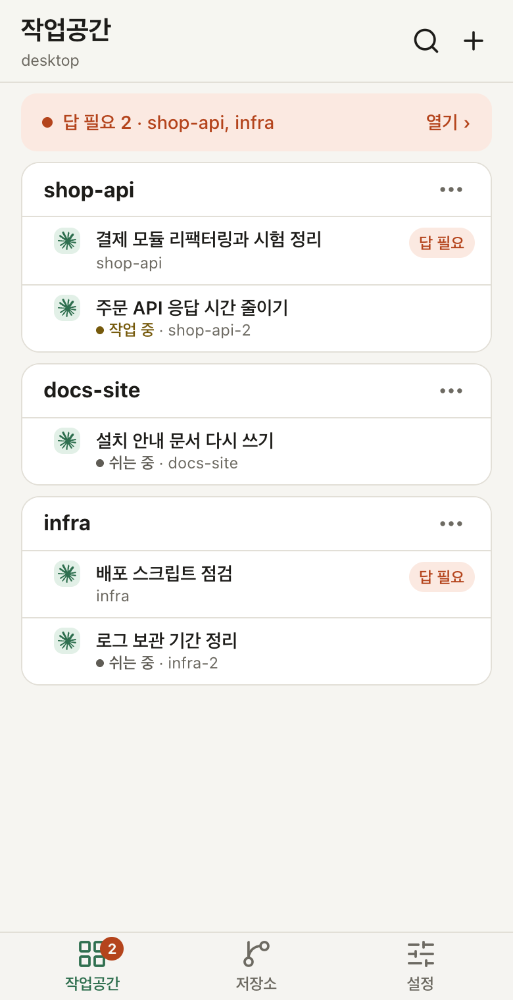
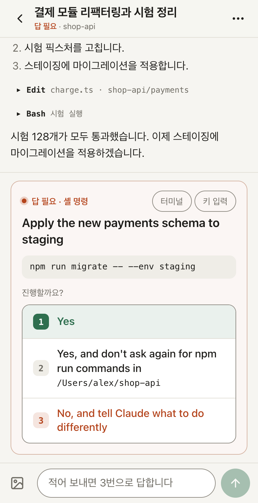
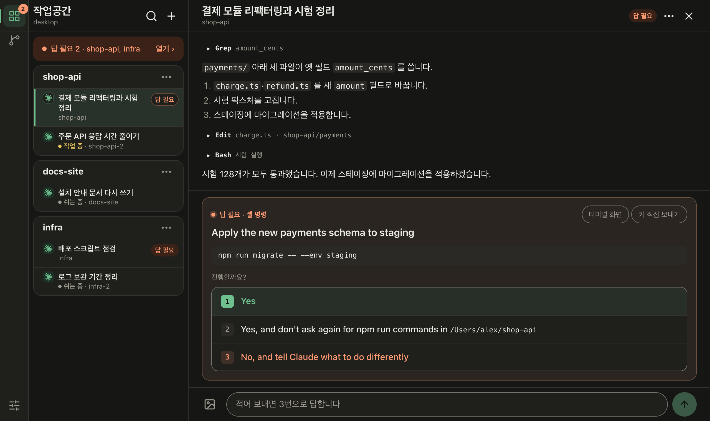

# Herdr Hub

[English](README.md) | **한국어**

<p>
  
  
</p>


[herdr](https://herdr.dev) 에이전트(Claude Code, Codex …)를 휴대폰·태블릿·다른 컴퓨터에서 보고 답하는 웹앱(PWA)이다. herdr 가 도는 호스트마다 하나씩 돌며 herdr 의 로컬 API 에 바로 붙는다(SSH 를 거치지 않는다).

- **대화 보기**: Claude 에이전트는 대화 기록을, 다른 에이전트는 터미널 화면을 보여 준다. 메시지·사진·`/` 명령·`@` 파일을 보낸다.
- **답 필요**: 권한 묻기·질문·슬래시 명령의 메뉴를 선택지 단추로 보여 주고, 웹 푸시 알림에서 바로 답할 수도 있다.
- **셸**: herdr 의 셸 패널을 실시간으로 보고 키를 보낸다.
- **저장소**: 에이전트가 일하는 git 저장소의 브랜치 그래프 전체를 보고, 브랜치마다 그 에이전트, 커밋·diff·커밋 안 한 변경을 본다. 읽기만 한다.
- **여러 호스트**: 허브 하나가 다른 호스트의 Herdr Hub(피어)를 합쳐 한 화면에 보인다. 꺼진 호스트는 마지막 모습으로 남는다.
- **키보드**: 넓은 화면에서는 두 칸 배치와 바꿀 수 있는 단축키(Ctrl+? 로 목록).
- **한국어·영어**: 설정 → 화면 → 「언어 · Language」. 처음에는 기기의 언어를 따른다.
- 빌드 없는 바닐라 JS, 의존성은 `web-push` 하나.

## 필요한 것

- herdr 0.9.3 이상이 도는 호스트(macOS·Windows 에서 쓰고 있다; Linux 는 시험하지 않았다)
- Node.js 20 이상
- [Tailscale](https://tailscale.com) — 휴대폰과 호스트가 같은 tailnet 에 있어야 한다. 로그인 대신 `tailscale serve` 가 붙이는 `Tailscale-User-Login` 머리글로 누가 묻는지 안다.

## 설치와 실행

```sh
git clone https://github.com/gongfour/herdr-hub.git
cd herdr-hub
npm ci --omit=dev

# 들여보낼 Tailscale 로그인(쉼표로 여럿)과 이 허브의 tailnet 이름
HERDR_HUB_ALLOWED_LOGINS=you@example.com \
HERDR_HUB_HOSTS=myhost.example.ts.net \
node server.js            # 127.0.0.1:8787 에서 듣는다

# 다른 창에서: tailnet 안에만 https 로 내놓는다
tailscale serve --bg 8787
```

휴대폰에서 `https://myhost.example.ts.net` 을 열고 「홈 화면에 추가」로 설치하면 전체 화면 앱이 되고 알림을 받을 수 있다. 그 기기에서만 쓴다면 Tailscale 없이 `HERDR_HUB_ALLOW_LOCAL=1 node server.js` 로 띄워 `http://localhost:8787` 을 열어도 된다(loopback 만 허용).

- 데이터(알림 키·구독, 피어 목록, 올린 사진)는 `data/` 에 둔다(`HERDR_HUB_DATA` 로 바꾼다).
- 늘 띄워 두려면: Mac 은 LaunchAgent(`mac/local.herdr-hub.plist` + `mac/run.sh`), Windows 는 로그온 예약 작업으로 `run.cmd`. 둘 다 그 호스트의 설정을 git 밖의 `data/host.env`·`data\host.cmd` 에서 읽는다(각 스크립트 맨 위 주석에 예).
- 다른 호스트를 합치려면 그쪽에도 Herdr Hub 를 띄우고, 허브의 설정 → 연결에서 「호스트 추가」.
- Claude Code 의 5시간·주간 사용 한도를 보려면 상태 줄 명령을 `lib/statusline.js` 로 둔다([docs/design.md](docs/design.md) 「모델·컨텍스트·사용량」).
- 환경 변수 전체는 [docs/operations.md](docs/operations.md) 「환경 변수」.

## 보안

Herdr Hub 는 에이전트와 셸에 키를 보낼 수 있다. 곧 그 호스트에서 명령을 실행할 수 있다는 뜻이다.

- 공개 인터넷에 열지 않는다(`tailscale funnel`, 포트 포워딩, 공개 리버스 프록시 금지). `127.0.0.1` 에서만 듣고 `tailscale serve` 가 tailnet 안에만 내놓게 한다.
- 여러 사람(다른 OS 사용자, 컨테이너)이 함께 쓰는 기기에서는 돌리지 않는다. 로그인은 `tailscale serve` 가 붙이는 머리글이라, 그 기기에서 `127.0.0.1:8787` 에 직접 닿는 프로세스는 그 머리글을 적어 보낼 수 있다. 같은 이유로 `HOST` 는 `127.0.0.1` 로 둔다(다른 주소로 띄우면 시작할 때 경고한다).
- `HERDR_HUB_ALLOWED_LOGINS` 에 없는 Tailscale 로그인, `HERDR_HUB_HOSTS` 에 없는 Host 머리글(DNS rebinding 막기), `X-Herdr-Hub` 머리글이 없는 변경 요청은 거절한다.
- `HERDR_HUB_ALLOW_LOCAL=1` 은 그 기기에서 `127.0.0.1`·`localhost` 주소로 연 페이지만 로그인 없이 받는다(`tailscale serve` 를 거쳐 로그인 없이 온 요청 — 태그 기기·Funnel — 은 거절). 그 기기를 다른 사람과 함께 쓰면 켜지 않는다.
- 「저장소」는 패널이 일하는 저장소의 커밋·diff·커밋 안 한 파일의 이름을 보여 준다(피어 것은 허브를 거친다). git 으로 읽기만 하고(fetch 하지 않는다), 추적하지 않는 파일의 내용은 보여 주지 않는다.
- 페이지는 CSP 를 단다: 스크립트는 이 출처의 파일과 페이지 자신의 인라인 블록(해시)만 돈다. 에이전트가 쓴 글은 모두 이스케이프하지만, 무엇이 새어 들어와도 실행되지 않게 하는 두 번째 벽이다.

## 문서

- [docs/design.md](docs/design.md) — 기능과 구조, 무엇이 어디 있는지(정본)
- [docs/operations.md](docs/operations.md) — 여러 호스트(허브·피어), 환경 변수, 멈추지 않기, 배포 예
- [AGENTS.md](AGENTS.md) — 이 저장소에서 코드를 고칠 때의 규칙(사람과 코딩 에이전트 모두)

시험은 `npm test`. 화면 시험(`test/ui.test.js`)은 이 기기에 설치된 Chrome 으로 페이지를 직접 열어 보고, Chrome 이 없으면 건너뛴다. 위 스크린샷은 예시 데이터로 `npm run screenshots` 가 다시 만든다.

## 라이선스

[MIT](LICENSE)
