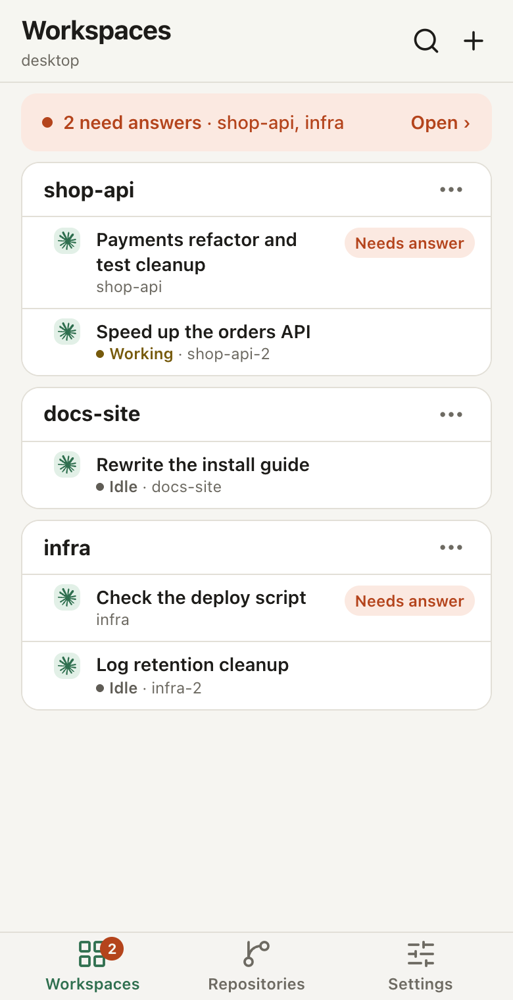
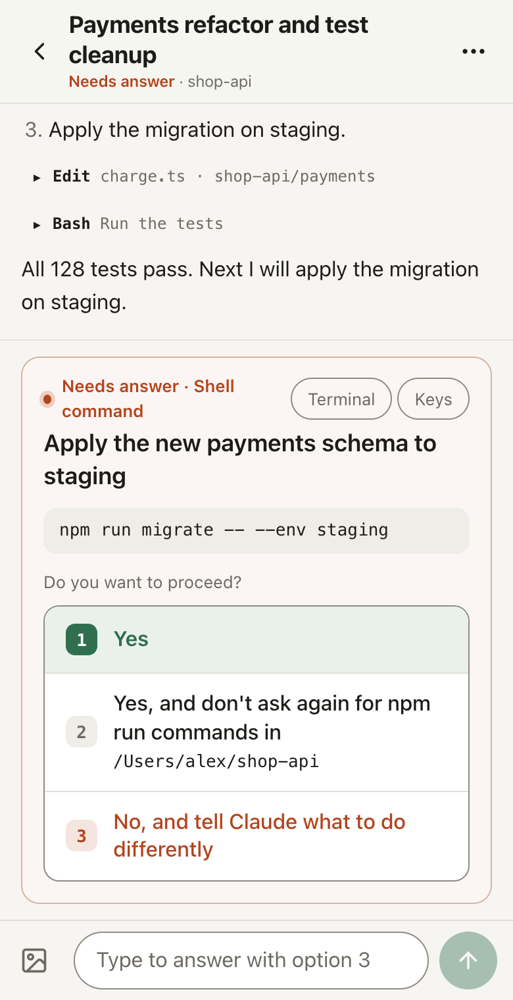
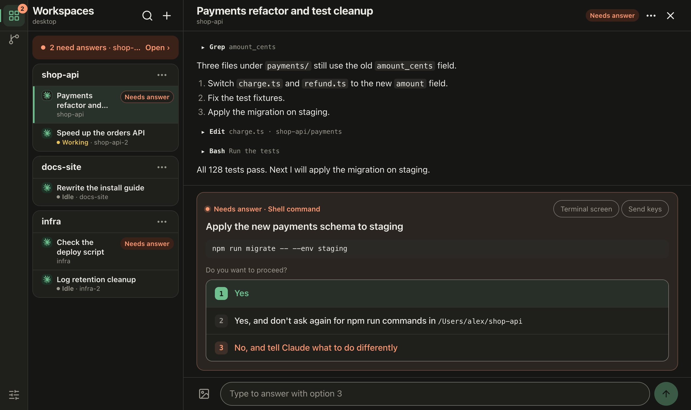

# Herdr Hub

**English** | [한국어](README.ko.md)

<p>
  
  
</p>


A web app (PWA) for watching and answering [herdr](https://herdr.dev) agents (Claude Code, Codex …) from a phone, a tablet or another computer. One runs on each host where herdr runs and talks to herdr's local API directly (no SSH in between).

- **Chats**: a Claude agent's conversation, or the terminal screen for other agents. Send messages, photos, `/` commands and `@` files.
- **Needs answer**: permission prompts, questions and slash-command menus as answer buttons; answer straight from a web push notification too.
- **Shell**: herdr's shell panes, live, with keys sent as you type.
- **Repositories**: the whole branch graph of the git repositories your agents work in, each agent at its branch, with commits, diffs and uncommitted changes. Read-only.
- **Several hosts**: one hub merges the Herdr Hubs of other hosts (its peers) into one view. A host that goes offline stays listed as it was last seen.
- **Keyboard**: a two-column layout on wide screens and shortcuts you can change (Ctrl+? lists them).
- **English and Korean**: Settings → Display → Language. A new device follows its own language.
- Vanilla JS with no build step; one dependency, `web-push`.

## Requirements

- A host running herdr 0.9.3 or later (used on macOS and Windows; Linux is untested)
- Node.js 20 or later
- [Tailscale](https://tailscale.com): the phone and the host on the same tailnet. There is no login of its own; it knows who is asking from the `Tailscale-User-Login` header that `tailscale serve` adds.

## Install and run

```sh
git clone https://github.com/gongfour/herdr-hub.git
cd herdr-hub
npm ci --omit=dev

# The Tailscale logins to let in (comma-separated) and this hub's tailnet name
HERDR_HUB_ALLOWED_LOGINS=you@example.com \
HERDR_HUB_HOSTS=myhost.example.ts.net \
node server.js            # listens on 127.0.0.1:8787

# In another terminal: serve it over https, inside the tailnet only
tailscale serve --bg 8787
```

Open `https://myhost.example.ts.net` on the phone and use "Add to Home Screen": it becomes a full-screen app and can receive notifications. For use on the same machine only, `HERDR_HUB_ALLOW_LOCAL=1 node server.js` and `http://localhost:8787` work without Tailscale (loopback only).

- Data (notification keys and subscriptions, the peer list, uploaded photos) lives in `data/` (`HERDR_HUB_DATA` moves it).
- To keep it running: a LaunchAgent on a Mac (`mac/local.herdr-hub.plist` + `mac/run.sh`), a logon scheduled task running `run.cmd` on Windows. Both read the host's own settings from `data/host.env` / `data\host.cmd`, outside git (examples at the top of each script).
- To merge another host, run Herdr Hub there too and use Settings → Connection → Add host on the hub.
- To see Claude Code's 5-hour and weekly usage limits, set its status line command to `node <hub folder>/lib/statusline.js` (details in docs/design.md).
- All environment variables are listed in [docs/operations.md](docs/operations.md).

## Security

Herdr Hub can send keys to agents and shells, which means it can run commands on that host.

- Never expose it to the public internet (no `tailscale funnel`, port forwarding or public reverse proxy). Let it listen on `127.0.0.1` only and have `tailscale serve` publish it inside the tailnet.
- Don't run it on a machine shared with other people (other OS users, containers). The login is a header `tailscale serve` adds, so any process that can reach `127.0.0.1:8787` directly can write that header. For the same reason keep `HOST` at `127.0.0.1` (it warns at start otherwise).
- Requests from a Tailscale login not in `HERDR_HUB_ALLOWED_LOGINS`, with a Host header not in `HERDR_HUB_HOSTS` (DNS rebinding), or changing something without the `X-Herdr-Hub` header are refused.
- `HERDR_HUB_ALLOW_LOCAL=1` admits without a login only a page opened on that machine at `127.0.0.1` or `localhost` (requests through `tailscale serve` without a login, from tagged devices or Funnel, are refused). Leave it off on a machine others use.
- Repositories shows commits, diffs and the names of uncommitted files of the repositories your panes work in (a peer's through the hub). It only reads, through git (never fetching), and never shows an untracked file's content.
- Pages carry a Content-Security-Policy: scripts run only from this origin and the page's own inline blocks (by hash). Everything an agent writes is escaped; this is a second wall so that nothing that slipped through can run.

## Documentation

The detailed documents are written in Korean:

- [docs/design.md](docs/design.md): features and structure, where everything is
- [docs/operations.md](docs/operations.md): several hosts (hub and peers), environment variables, staying responsive, an example deployment
- [AGENTS.md](AGENTS.md): the rules for changing code in this repository (for people and coding agents)

Tests: `npm test`. The UI tests (`test/ui.test.js`) open the page in the Chrome installed on the machine, and are skipped where there is none. The screenshots above are made from example data by `npm run screenshots`.

## License

[MIT](LICENSE)
